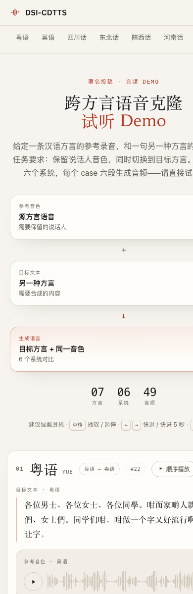

# DSI-CDTTS — Cross-Dialect Voice Cloning Demo

An anonymous audio demo page for a paper under review. One page, seven Chinese
dialects, six systems, 42 generated clips plus 7 reference recordings — playable
in any modern browser with no server, no build step and no external requests.

**Live page:** <https://opendialect.github.io/DSI-CDTTS/>

> **For reviewers:** open the link above, or unzip the supplementary archive
> and double-click `index.html`. Both show the same page; the offline copy needs
> no network at all.

## What the demo shows

The task is cross-dialect voice cloning: given a reference recording of a
speaker in one Chinese dialect and a sentence written in a different dialect,
synthesise that sentence in the target dialect while keeping the speaker's
voice.

Every case on the page contains:

- the **reference recording** (source dialect, used only as the speaker
  identity reference — it is not a scoring clip),
- the **target text** that was synthesised,
- **six generated clips**, one per system, in a fixed order.

No objective or subjective scores (SIM, CER, SMOS, DMOS) are shown on the page
by design — all numbers live in the paper so that listening is not primed.

## Page features

- **Waveform players** — envelopes are precomputed at build time, so the page
  never decodes audio just to draw; click or drag to seek, and only one clip
  plays at a time.
- **Play all** per case — auditions the six systems back to back, skipping any
  clip that fails to load.
- **English / 中文 toggle**, light / dark theme, both remembered locally.
- **Keyboard** — `Space` play/pause, `←` `→` seek 5 s, `Esc` stop.
- **Deep links** — `index.html#case-03_sichuan_s19` opens a case directly.
- **Offline-first** — relative URLs, inline SVG, no CDN, no analytics, no fonts
  to fetch. Works from `file://` as well as from Pages.

## Repository layout

```text
index.html              the whole page (static shell)
assets/
  style.css             themes, layout, player styling
  app.js                player, i18n, theme, sequence, keyboard
  data.js               generated: cases, texts, model labels
  peaks.js              generated: waveform envelopes + durations
cases/
  01_yue_s22/ … 07_minnan_s29/
    text.txt            target text
    ref.mp3             reference recording (16 kHz)
    01_main.mp3 … 06_voxcpm2_base.mp3   six systems (48 kHz)
tools/
  build_peaks.py        ffmpeg + numpy → assets/peaks.js
  build_data.py         manifest.json → assets/data.js
  qa_check.py           link check + headless-Chrome audit
  audit.js              assertions injected only into the QA copy
  init_git_anonymous.sh create the repo with an anonymous commit identity
  package_offline.sh    zip for supplementary material
docs/                   preview screenshots used by this README
.github/workflows/      keeps the gh-pages branch in sync with main
```

## Preview locally

```sh
# simplest: no server needed
open index.html

# or serve it (closest to GitHub Pages)
python3 -m http.server 8000
# → http://localhost:8000
```

## Publishing

The page is live at <https://opendialect.github.io/DSI-CDTTS/>, served by GitHub
Pages from the `gh-pages` branch. A small workflow
(`.github/workflows/sync-gh-pages.yml`) force-updates `gh-pages` to `main` on
every push, so redeploying is just:

```sh
git push origin main
```

For a fresh anonymous account, see **[DEPLOY.md](DEPLOY.md)** for the full
checklist (anonymous account, deploy key, Pages source, verification). The
remote in this checkout already points at
`git@github.com:OpenDialect/DSI-CDTTS.git`:

```sh
git remote set-url origin git@github.com:<anon-account>/<repo>.git   # optional
git push origin main
```

## Package for supplementary material

```sh
./tools/package_offline.sh
# → DSI-CDTTS-demo-page.zip (~3.5 MB)
```

The archive contains `index.html`, `assets/`, `cases/`, `docs/`, `tools/`,
`README.md`, `LICENSE` and `.nojekyll` — everything needed to listen offline,
plus the scripts. It deliberately omits the deployment checklist (`DEPLOY.md`)
and the git history. Reviewers unzip it and double-click `index.html`.

## Rebuilding generated assets

The two generated files are committed so the site stays a pure static bundle;
regenerate them only if the audio or case list changes.

```sh
python3 tools/build_peaks.py                              # needs ffmpeg + numpy
python3 tools/build_data.py path/to/manifest.json         # needs the demo manifest
```

`manifest.json` is intentionally **not** committed: it contains per-clip
objective/subjective scores that this page deliberately does not expose.

## Quality checks

```sh
python3 tools/qa_check.py            # link check + headless Chrome audit (file://)
python3 tools/qa_check.py --serve    # same audit over HTTP, like GitHub Pages
python3 tools/qa_check.py --shots    # refresh docs/preview-*.png
```

Requires a local Chrome/Chromium/Edge; the script exits non-zero if none is
found or any check fails. The audit covers structure (7 cases, 42 model clips,
49 audio players, 49 waveforms), layout at desktop / tablet / phone widths,
horizontal overflow, sticky-header anchor offsets, both languages, both themes
including text contrast in each, canvas repaint, lazy audio loading,
play/pause exclusivity, waveform seeking, the "Play all" sequence (including
state cleanup and skipped failures), keyboard shortcuts (`Space`, arrows,
`Esc`) and the deep-link scroll.

## Anonymity notes

- No author names, affiliations, e-mails, ORCIDs or acknowledgements.
- No speaker names — only dialect and region are shown.
- MP3 tags contain nothing but the ffmpeg encoder string.
- `manifest.json` (scores) is not part of this repository.
- Commits use a repo-local fake identity
  (`Anonymous Author <anonymous@example.com>`); the host's global git identity
  is personal, so only push with the anonymous deploy key and check
  `git log --all --format='%an <%ae>'` before pushing.
- The pushing GitHub account is visible in repository/activity metadata:
  push from the anonymous account itself rather than granting a personal
  account collaborator access.

## Provenance and licence

Clips were exported from the evaluation set `7dialect_d2d_9ref_v4`; reference
recordings come from the dialect corpus used for evaluation. They are included
here for anonymous review — see [LICENSE](LICENSE). Do not redistribute the
audio. Note that a GitHub Pages site is publicly readable; `noindex` only asks
search engines not to index it.

## 中文速览

这是一个给审稿人看的匿名试听页：7 个汉语方言 × 6 个系统，共 42 段生成音频 +
7 段参考录音。线上地址 <https://opendialect.github.io/DSI-CDTTS/>，也可以解压
补充材料后双击 `index.html` 离线试听。页面不展示任何客观/主观指标（指标见论文），
不包含作者信息、说话人姓名和外链，MP3 标签仅含编码器字符串。

- 试听：双击 `index.html`，或 `python3 -m http.server 8000`
- 发布：`git push origin main`（工作流会自动同步到 `gh-pages`）
- 打包附件：`./tools/package_offline.sh`
- 自检：`python3 tools/qa_check.py`（需要本机 Chrome）



