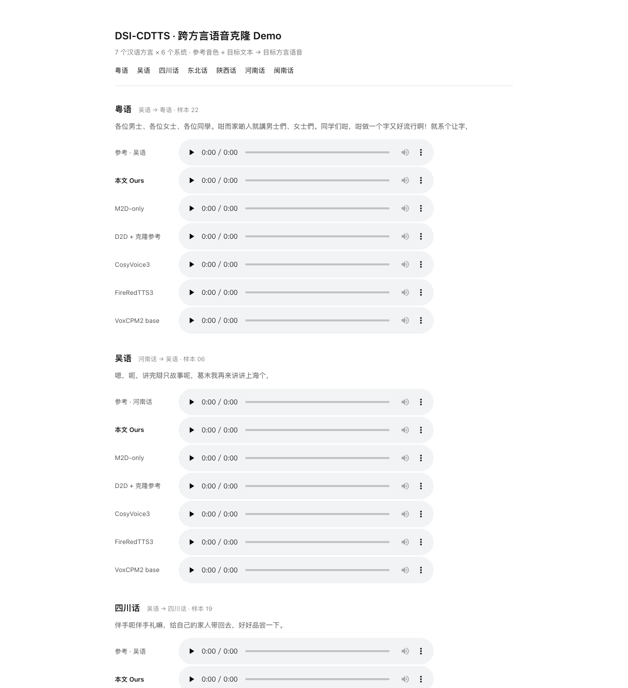

# DSI-CDTTS — Cross-Dialect Voice Cloning Demo

A plain static page for anonymous review: seven Chinese dialects, six systems,
42 generated clips plus 7 reference recordings. White background, native browser
audio players, no JavaScript framework and no build step.

**Live page:** <https://opendialect.github.io/DSI-CDTTS/>

Each case shows the reference recording, the target sentence, and one player
per system (the first one is ours). No objective or subjective scores are shown
on the page — all numbers are in the paper.



## View locally

```sh
open index.html
# or
python3 -m http.server 8000    # http://localhost:8000
```

## Publish

The page is served by GitHub Pages from `gh-pages`, which
`.github/workflows/sync-gh-pages.yml` keeps in sync with `main`. Redeploying is
just:

```sh
git push origin main
```

For a fresh anonymous account see [DEPLOY.md](DEPLOY.md).

## Repository layout

```text
index.html           generated static page
assets/style.css     the only stylesheet (~2 KB)
cases/               7 case folders: text.txt, ref.mp3, 6 model clips
tools/
  build_site.py      regenerate index.html from the demo manifest
  package_offline.sh zip for supplementary material
  init_git_anonymous.sh  create the repo with an anonymous commit identity
docs/                preview screenshot
```

## Regenerate the page

`index.html` is generated once and committed, so the repository stays a pure
static bundle. After changing audio or case selection:

```sh
python3 tools/build_site.py /path/to/demo_7dialects_6models/manifest.json
```

The script also fails if any referenced audio file is missing. The manifest is
not committed (it contains per-clip scores).

## Supplementary zip

```sh
./tools/package_offline.sh
# → DSI-CDTTS-demo-page.zip (~3.4 MB)
```

Reviewers unzip it and double-click `index.html`; everything plays offline.

## Anonymity

- No author names, affiliations, e-mails or speaker names on the page.
- Commits use a repo-local fake identity; push only with the anonymous deploy
  key (the host's global git identity is personal).
- MP3 tags contain only the ffmpeg encoder string; scores are not committed.

## Licence

Audio and page are provided for anonymous review only — see [LICENSE](LICENSE).
Do not redistribute the recordings.

## 中文

白色背景的静态试听页：7 个方言 × 6 个系统，每个 case 一条参考音频、一句目标
文本、7 个播放器（参考 + 6 个系统，第一个是本文）。无脚本框架、无构建步骤，
双击 `index.html` 即可离线试听；发布只需 `git push origin main`。
